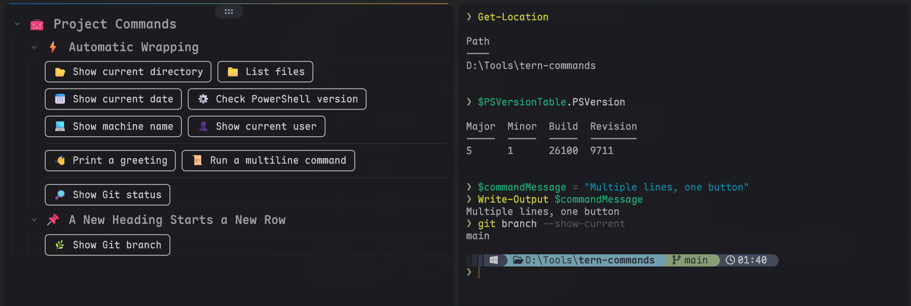

# Tern Commands

Run `COMMANDS.md` code blocks from a searchable command picker or grouped buttons in [Tern](https://stencil.so/tern).



## Install

Install directly from GitHub (requires Git):

```sh
tern plugin install https://github.com/lucaxic/tern-commands.git
```

To update an installed copy:

```sh
tern plugin install https://github.com/lucaxic/tern-commands.git --force
```

For local development, run from this plugin's directory:

```sh
tern plugin link .
```

## Usage

Create a `COMMANDS.md` file in your working directory, then choose **Select Commands...** from the command palette or use the shortcut:

- **macOS:** Control+Shift+Command+C
- **Windows / Linux:** Ctrl+Alt+Shift+C

The picker groups commands by Markdown headings and shows their shell label and command text. Type to filter, press **Enter** to run the selected command, or **Esc** to cancel. The file is read each time the picker opens.

**Open Commands...** still opens the grouped button panel. The existing right-click opening option for `COMMANDS.md` is unchanged.

Both picking a command and clicking a panel button run it in the original tab's first idle terminal at a shell prompt. If none is available, a terminal is created. Existing terminals keep their current directory and session state; busy terminals are left untouched.

In the panel, hover to preview a command. Commands are read once when the panel opens; reopen it after editing `COMMANDS.md`. Buttons execute the displayed snapshot, with no polling or refresh key. Execution errors appear as notifications; file-loading errors appear in the panel or as a notification when opening the picker. Normal Markdown opening is unchanged.

On macOS, terminal-control CLI calls use an interactive login zsh so they can find `tern` through your shell's PATH even when Tern was launched from Finder. Keep shell startup output on stderr; stdout is used for CLI results.

## Example

````markdown
# Project

## Development

Show directory
```powershell
Get-Location
```

Git status
```powershell
git status --short
```
````

- Headings create collapsible groups.
- Text immediately above a code block becomes its button label.
- Buttons wrap automatically. Use `---` or `***` to add a divider and start a new row.
- Supported code-block labels: `sh`, `powershell`, `pwsh`, `cmd`, `bash`, and `zsh`.
- `sh` runs the text unchanged in the selected terminal's current shell on every platform. If a new terminal is needed, it uses Tern's default shell. On Windows this may be PowerShell or CMD; `sh.exe` is not required.
- Other labels select the named shell. `sh` does not translate syntax: write commands that the selected shell understands.

See [assets/COMMANDS.md](assets/COMMANDS.md) for more examples.
